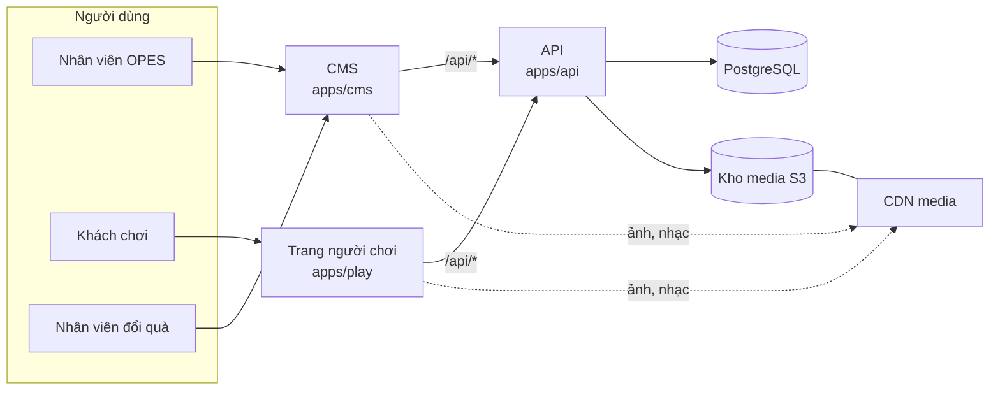

# 01. Kiến trúc

## Các thành phần



| Thành phần | Vai trò | Công nghệ |
|---|---|---|
| **CMS** (`apps/cms`) | Trang quản trị cho nhân viên OPES, gồm cả trang đổi quà | Next.js, React, TypeScript |
| **Trang người chơi** (`apps/play`) | Chạy chiến dịch đã xuất bản tại `/c/<slug>`, và link chơi thử template tại `/try/<token>` | Next.js, React, TypeScript; game vẽ bằng Canvas |
| **API** (`apps/api`) | Nơi duy nhất đọc/ghi dữ liệu. Luật chơi, phát quà, chống gian lận, đăng nhập CMS | Hono (TypeScript), chạy được trên Vercel và trong Docker |
| **Cơ sở dữ liệu** | Toàn bộ dữ liệu nghiệp vụ | PostgreSQL. Chạy tạm: Neon |
| **Kho media** | Ảnh, nhạc, âm thanh tải lên từ CMS | Giao thức S3. Chạy tạm: Cloudflare R2. Chạy máy chủ riêng: MinIO |

**Nguyên tắc ranh giới:** CMS và trang người chơi **không bao giờ** kết nối trực tiếp tới cơ sở dữ liệu. Mọi thao tác đều qua API. Nhờ vậy có thể thay giao diện, thêm ứng dụng di động, hoặc mở API cho đối tác sau này mà không đụng tới dữ liệu.

## Vì sao chọn những công nghệ này

- **Hono** cho API: một mã nguồn chạy được cả dạng hàm serverless trên Vercel lẫn máy chủ Node.js trong Docker. Đây là chìa khóa để "chạy tạm trên Vercel, chuyển nhà dễ".
- **Drizzle ORM** cho truy vấn và migration: viết SQL chuẩn PostgreSQL, không khóa vào nhà cung cấp nào.
- **Zod** để mô tả dữ liệu đầu vào/đầu ra của API và lược đồ cấu hình module. Một định nghĩa dùng chung cho API, CMS và trang người chơi.
- **pnpm workspaces + Turborepo** cho monorepo: 3 ứng dụng dùng chung kiểu dữ liệu và module, nhưng build và triển khai độc lập.

## Cấu trúc repo

```
game-hub/
├─ apps/
│  ├─ api/            API Hono: routes, dịch vụ nghiệp vụ, xác thực
│  ├─ cms/            Next.js: trang quản trị + trang đổi quà
│  └─ play/           Next.js: trang người chơi /c/<slug>
├─ packages/
│  ├─ module-sdk/     Chuẩn module: kiểu dữ liệu, các loại trường cấu hình, sự kiện
│  ├─ modules/
│  │  ├─ game-catch/          Template game Hứng quà rơi
│  │  ├─ leaderboard-podium/  Template bảng xếp hạng
│  │  └─ reward-wheel/        Template vòng quay cổ điển
│  ├─ schema-form/    Tự sinh form CMS từ lược đồ cấu hình module
│  ├─ db/             Lược đồ Drizzle, migration SQL, dữ liệu mẫu
│  ├─ contracts/      Zod schema cho request/response của API
│  ├─ i18n/           Chuỗi giao diện (vi, sẵn chỗ cho en)
│  └─ ui/             Thành phần giao diện dùng chung
├─ docker/            Dockerfile cho từng ứng dụng
├─ docker-compose.yml Chạy toàn bộ hệ thống trên một máy (kèm PostgreSQL + MinIO)
├─ docs/              Tài liệu thiết kế
└─ .github/workflows/ Kiểm tra tự động (lint, typecheck, test)
```

Module được đặt trong `packages/modules/` và **đăng ký** vào một danh mục. CMS dùng danh mục để hiển thị form cấu hình; trang người chơi dùng nó để chạy; API dùng nó để kiểm tra cấu hình và điểm.

## Gọi API cùng tên miền

`*.vercel.app` là các tên miền khác nhau, nên trình duyệt sẽ chặn cookie gửi chéo giữa `opes-play.vercel.app` và `opes-api.vercel.app`. Để tránh vấn đề này, CMS và trang người chơi **chuyển tiếp** đường dẫn `/api/*` của chính mình sang API (rewrites của Next.js). Với trình duyệt, mọi lời gọi đều cùng tên miền, nên cookie phiên hoạt động bình thường và không cần cấu hình CORS phức tạp.

## Triển khai

### Chạy tạm (miễn phí)

| Thành phần | Nơi chạy | Tên miền |
|---|---|---|
| CMS | Vercel | `opes-cms.vercel.app` (tên cụ thể chọn khi tạo) |
| Trang người chơi | Vercel | `opes-play.vercel.app` |
| API | Vercel (Hono serverless) | `opes-api.vercel.app` |
| PostgreSQL | Neon, gói miễn phí | không công khai |
| Media | Cloudflare R2, gói miễn phí | tên miền `r2.dev` hoặc tên miền riêng sau này |

- Ba **dự án Vercel** cùng trỏ vào repo này, mỗi dự án một thư mục gốc (`apps/cms`, `apps/play`, `apps/api`).
- Đẩy code lên `main` → Vercel tự triển khai bản chính. Mở pull request → Vercel tạo **link xem trước** riêng cho pull request đó.
- GitHub Actions chạy kiểm tra (lint, typecheck, test) trên mỗi pull request.
- Migration cơ sở dữ liệu chạy bằng một lệnh riêng (`pnpm db:migrate`), không tự chạy khi triển khai, để tránh thay đổi dữ liệu ngoài ý muốn.

> **Lưu ý điều khoản:** gói miễn phí (Hobby) của Vercel chỉ dành cho mục đích phi thương mại. Khi chạy chiến dịch thật cho nhãn hàng, cần nâng gói Pro hoặc chuyển sang máy chủ riêng.

### Chuyển sang máy chủ riêng

`docker-compose.yml` chạy cả 3 ứng dụng cùng PostgreSQL và MinIO trên một máy. Các bước chuyển:

1. Xuất dữ liệu từ Neon (`pg_dump`), nhập vào PostgreSQL mới.
2. Sao chép media từ R2 sang kho S3 mới (lệnh `rclone sync`).
3. Đổi biến môi trường (`DATABASE_URL`, `S3_*`, `MEDIA_PUBLIC_URL`, tên miền).
4. `docker compose up -d`.

Không phải sửa code.

## Biến môi trường chính

| Biến | Dùng ở | Ý nghĩa |
|---|---|---|
| `DATABASE_URL` | api | Chuỗi kết nối PostgreSQL |
| `S3_ENDPOINT`, `S3_BUCKET`, `S3_ACCESS_KEY_ID`, `S3_SECRET_ACCESS_KEY`, `S3_REGION` | api | Kho media |
| `MEDIA_PUBLIC_URL` | api | Địa chỉ công khai để hiển thị ảnh, nhạc |
| `SESSION_SECRET` | api | Khóa ký phiên CMS và phiên người chơi |
| `PLAY_PUBLIC_URL` | api, cms | Địa chỉ trang người chơi, dùng để tạo link và QR |
| `API_INTERNAL_URL` | cms, play | Địa chỉ API mà rewrites chuyển tiếp tới |
