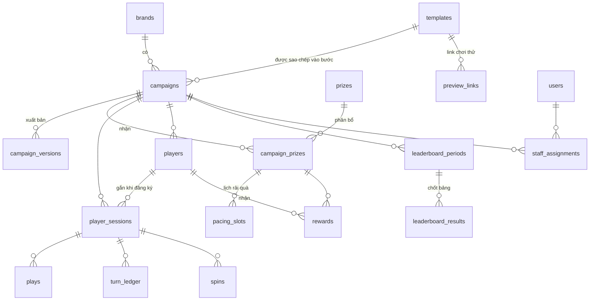

# 03. Dữ liệu

Cơ sở dữ liệu PostgreSQL. Khóa chính dạng UUID. Mọi thời điểm lưu `timestamptz`; hiển thị theo giờ Việt Nam (`Asia/Ho_Chi_Minh`). "Ngày" trong luật (lượt/ngày, giới hạn/ngày, kỳ theo ngày) tính theo giờ Việt Nam.

## Sơ đồ quan hệ



## Quản trị

**`users`**: nhân viên OPES

| Cột | Kiểu | Ghi chú |
|---|---|---|
| id | uuid | |
| email | text, duy nhất | Đăng nhập |
| name | text | |
| password_hash | text | Băm bằng Argon2id |
| role | enum | `admin`, `operator`, `redeemer`, `viewer` |
| status | enum | `active`, `disabled` |
| last_login_at | timestamptz | |

**`staff_assignments`**: nhân viên đổi quà được giao chiến dịch nào (`user_id`, `campaign_id`).

**`admin_sessions`**: phiên đăng nhập CMS, để có thể thu hồi (`id`, `user_id`, `expires_at`, `revoked_at`, `ip`, `user_agent`).

**`audit_logs`**: ai làm gì, lúc nào (`user_id`, `action`, `entity`, `entity_id`, `data`, `created_at`). Ghi cho xuất bản, sửa kho quà, duyệt xếp hạng, trao quà, đổi vai trò.

## Tài nguyên dùng chung

**`media`**: mọi file tải lên

| Cột | Kiểu | Ghi chú |
|---|---|---|
| id | uuid | |
| storage_key | text | Đường dẫn trong kho S3 |
| kind | enum | `image`, `audio` |
| mime, size_bytes, width, height, duration_ms | | |
| uploaded_by | uuid → users | |

Cấu hình module lưu `media.id`; API chuyển thành URL công khai khi trả cho trang người chơi. Đổi kho media chỉ cần đổi `MEDIA_PUBLIC_URL`.

**`brands`**: hồ sơ nhãn hàng

| Cột | Kiểu | Ghi chú |
|---|---|---|
| id, name | | |
| theme | jsonb | Logo, màu chính/phụ/nền/chữ, font tiêu đề/nội dung, ảnh nền, bo góc nút |
| archived_at | timestamptz | |

**`templates`**: thư viện template

| Cột | Kiểu | Ghi chú |
|---|---|---|
| id, name, description | | |
| module_key | text | Ví dụ `game.catch` |
| module_version | text | |
| config | jsonb | Đã kiểm tra theo lược đồ module |
| revision | int | Tăng mỗi lần lưu; dùng cho "Đồng bộ từ template" |
| archived_at | timestamptz | |

**`preview_links`**: link chơi thử của template

| Cột | Kiểu | Ghi chú |
|---|---|---|
| id | uuid | |
| token | text, duy nhất | 22 ký tự ngẫu nhiên (128 bit) trong địa chỉ `/try/<token>` |
| template_id | uuid → templates | |
| label | text | Tên gợi nhớ, ví dụ "Gửi chị Lan – Trà Sen Mây" |
| mode | enum | `live` (luôn đọc cấu hình mới nhất của template) hoặc `snapshot` |
| snapshot | jsonb, null | Với `snapshot`: module, phiên bản, cấu hình, giao diện tại lúc tạo |
| brand_id | uuid, null | Hồ sơ nhãn hàng dùng làm giao diện khi chơi thử |
| password_hash | text, null | Có giá trị thì phải nhập mật khẩu |
| expires_at | timestamptz, null | |
| disabled_at | timestamptz, null | |
| view_count, last_viewed_at | | Biết link đã được mở chưa |
| created_by, created_at | | |

Link chơi thử **không** tạo phiên người chơi, lượt chơi hay phiếu quà nào.

## Kho quà

**`prizes`**: kho tổng

| Cột | Kiểu | Ghi chú |
|---|---|---|
| id, name, description | | |
| image_media_id | uuid → media | |
| value_vnd | bigint | Giá trị quà, dùng cho báo cáo |
| fulfillment | enum | `counter` (nhận tại quầy) hoặc `shipping` (giao tận nơi) |
| total_qty | int | Tổng số lượng nhập kho |
| archived_at | timestamptz | |

Số còn trong kho tổng = `total_qty` − tổng `allocated_qty` của mọi phân bổ.

**`campaign_prizes`**: phân bổ quà cho chiến dịch

| Cột | Kiểu | Ghi chú |
|---|---|---|
| id | uuid | |
| campaign_id, prize_id | uuid | |
| purpose | enum | `random` (vòng quay) hoặc `leaderboard` |
| allocated_qty | int | Số lượng giao cho chiến dịch |
| issued_qty | int | Số đã phát (cập nhật trong giao dịch phát quà) |
| daily_limit | int, null | Tối đa phát mỗi ngày |
| weight | int | Trọng số, dùng khi chiến dịch chọn cách "trọng số + tồn kho" |
| per_player_limit | int, null | Mỗi người tối đa bao nhiêu món này |

Ràng buộc: `issued_qty <= allocated_qty`; tổng `allocated_qty` của một món không vượt `total_qty` (kiểm tra trong giao dịch khi phân bổ). Khi chiến dịch kết thúc, quản trị viên bấm "Trả quà dư về kho" để hạ `allocated_qty` xuống bằng `issued_qty`.

**`pacing_slots`**: lịch rải quà, chỉ dùng khi chiến dịch chọn "rải đều theo thời gian"

| Cột | Kiểu | Ghi chú |
|---|---|---|
| id | uuid | |
| campaign_prize_id | uuid | |
| release_at | timestamptz | Thời điểm suất quà này được "mở" |
| reward_id | uuid, null | Đã có người nhận chưa |

## Chiến dịch

**`campaigns`**

| Cột | Kiểu | Ghi chú |
|---|---|---|
| id | uuid | |
| brand_id | uuid → brands | |
| name | text | Tên nội bộ |
| slug | text, duy nhất | Đường dẫn công khai `/c/<slug>` |
| status | enum | `draft`, `scheduled`, `live`, `paused`, `ended` |
| starts_at, ends_at | timestamptz | |
| draft | jsonb | Bản nháp đang sửa (cấu trúc bên dưới) |
| published_version_id | uuid, null | Bản đang chạy |
| created_by | uuid → users | |

**`campaign_versions`**: mỗi lần xuất bản là một bản chụp không đổi

| Cột | Kiểu | Ghi chú |
|---|---|---|
| id, campaign_id | | |
| version | int | 1, 2, 3… |
| snapshot | jsonb | Bản sao đầy đủ của `draft` lúc xuất bản, đã chạy `migrate()` |
| published_by, published_at, note | | |

Quay lại bản cũ = xuất bản lại snapshot của bản đó thành bản mới.

**Cấu trúc `draft` / `snapshot`**

```jsonc
{
  "theme": { "brandId": "…", "overrides": { "primary": "#d84315" } },
  "profileForm": {
    "when": "before_play",              // hoặc "before_claim"
    "fields": [                          // biệt danh + SĐT luôn có
      { "key": "fullName", "type": "text", "required": false },
      { "key": "province", "type": "province", "required": true }
    ],
    "consentText": "…"
  },
  "steps": [
    { "id": "s1", "moduleKey": "game.catch", "moduleVersion": "1.0.0",
      "templateId": "…", "templateRevision": 3, "config": { } },
    { "id": "s2", "moduleKey": "reward.wheel", "moduleVersion": "1.0.0", "config": { } },
    { "id": "s3", "moduleKey": "leaderboard.podium", "moduleVersion": "1.0.0", "config": { "sourceStepId": "s1" } }
  ],
  "flow": { "start": "s1", "navigation": "tabs" }, // tuần tự hoặc thanh tab giữa các bước
  "rules": [
    { "type": "free_spins", "amount": 3, "per": "day" },
    { "type": "game_play_limit", "stepId": "s1", "amount": 5, "per": "day" },
    { "type": "max_rewards_per_player", "amount": 2 }
  ],
  "prizeDistribution": { "mode": "weighted", "loseWeight": 60, "claimProfileMinutes": 30 }, // mode: weighted | paced
  "leaderboard": {
    "stepId": "s3", "sourceStepId": "s1",
    "scoring": "best",                  // hoặc "sum"
    "periods": { "mode": "weekly" },    // daily | weekly | whole | custom
    "rankPrizes": [ { "fromRank": 1, "toRank": 1, "campaignPrizeId": "…" },
                    { "fromRank": 2, "toRank": 5, "campaignPrizeId": "…" } ]
  },
  "legal": { "termsText": "…", "permitNumber": "" }
}
```

## Người chơi và hoạt động

**`player_sessions`**: phiên ẩn danh, tạo ngay khi mở link

| Cột | Kiểu | Ghi chú |
|---|---|---|
| id | uuid | Nằm trong cookie đã ký |
| campaign_id | uuid | |
| player_id | uuid, null | Gắn khi người chơi nhập thông tin |
| device_hash | text | Băm từ thông tin thiết bị, dùng giới hạn lượt |
| ip_hash | text | Băm IP, không lưu IP gốc |
| created_at, last_seen_at | | |

**`players`**: người chơi đã nhập thông tin

| Cột | Kiểu | Ghi chú |
|---|---|---|
| id, campaign_id | | |
| nickname | text | Hiện trên bảng xếp hạng; lọc từ ngữ không phù hợp |
| phone | text | Chuẩn hóa dạng `0xxxxxxxxx`; duy nhất trong một chiến dịch |
| extra | jsonb | Các trường thêm của chiến dịch |
| consent_at | timestamptz | Thời điểm đồng ý điều khoản |
| blocked_at | timestamptz, null | Quản trị viên chặn khi gian lận |

Một số điện thoại = một người chơi trong một chiến dịch. Nếu người chơi đổi máy và nhập lại số cũ, phiên mới được gắn vào người chơi cũ, lượt đã dùng vẫn giữ nguyên.

**`plays`**: lượt chơi game

| Cột | Kiểu | Ghi chú |
|---|---|---|
| id | uuid | |
| campaign_id, step_id, version_id | | |
| session_id, player_id | | |
| seed | int | Hạt giống ngẫu nhiên máy chủ cấp |
| started_at, finished_at | timestamptz | Thời điểm do máy chủ ghi |
| score | int | |
| stats | jsonb | Thống kê module gửi lên |
| status | enum | `started`, `valid`, `suspect`, `expired` |

**`turn_ledger`**: sổ lượt quay

| Cột | Kiểu | Ghi chú |
|---|---|---|
| id, campaign_id | | |
| owner_key | text | `player:<id>` nếu đã đăng ký, ngược lại `session:<id>` |
| delta | int | +n khi được cộng, −1 khi quay |
| reason | text | `free_spins`, `spin`, sau này `score_reward`, `promo_code`… |
| period_key | text | Ví dụ `2026-11-02` cho luật theo ngày; chống cộng trùng |
| ref_id | uuid, null | Lượt chơi hoặc lượt quay liên quan |

Số lượt còn lại = tổng `delta`. Có chỉ mục duy nhất trên (`owner_key`, `reason`, `period_key`) cho các khoản cộng tự động, để không bị cộng hai lần.

**`spins`**: lượt quay (`id`, `campaign_id`, `session_id`, `player_id`, `campaign_prize_id` null nếu trượt, `reward_id`, `created_at`).

**`rewards`**: phiếu quà đã phát

| Cột | Kiểu | Ghi chú |
|---|---|---|
| id | uuid | |
| campaign_id, campaign_prize_id, prize_id | | |
| player_id | uuid, null | Null khi đang chờ người chơi nhập thông tin (chế độ "nhập khi trúng") |
| session_id | uuid | |
| source | enum | `random` hoặc `leaderboard` |
| source_ref | uuid | Lượt quay hoặc kết quả xếp hạng |
| claim_code | text, duy nhất | Mã nhận quà 8 ký tự dễ đọc (không có 0/O, 1/I), cũng mã hóa trong QR |
| fulfillment | enum | `counter` hoặc `shipping` |
| status | enum | Xem vòng đời bên dưới |
| shipping | jsonb | Họ tên, SĐT nhận, địa chỉ, ghi chú, mã vận đơn |
| issued_at, claim_deadline | timestamptz | |
| redeemed_at, redeemed_by | | Ai trao, lúc nào |

Vòng đời phiếu quà:

```
pending_profile ─(nhập thông tin)─► issued
issued ─(tại quầy: nhân viên xác nhận)──────────────► redeemed
issued ─(giao hàng: người chơi điền địa chỉ)─► awaiting_shipment ─► shipped ─► delivered
issued/pending_profile ─(quá hạn)─► expired (quà trả lại phân bổ)
mọi trạng thái chưa xong ─(quản trị viên hủy)─► cancelled (quà trả lại phân bổ)
```

## Xếp hạng

**`leaderboard_periods`** (`id`, `campaign_id`, `step_id`, `label`, `starts_at`, `ends_at`, `status`: `open`, `closed`, `approved`). Được tạo khi xuất bản, theo cấu hình kỳ.

**`leaderboard_results`**: kết quả chốt bảng

| Cột | Kiểu | Ghi chú |
|---|---|---|
| id, period_id | | |
| rank | int | |
| player_id | uuid | |
| score | int | |
| campaign_prize_id | uuid, null | Quà đề xuất theo hạng |
| status | enum | `proposed`, `approved`, `disqualified` |
| reward_id | uuid, null | Phiếu quà sau khi duyệt |

Trong kỳ đang mở, bảng xếp hạng được **tính trực tiếp** từ `plays` hợp lệ (chỉ mục trên `campaign_id, step_id, status, score`). Với quy mô vài nghìn người chơi, truy vấn này đủ nhanh; API lưu đệm kết quả khoảng 15 giây.

## Hạ tầng phụ

- **`rate_limits`** (`key`, `window_start`, `count`): đếm số lời gọi theo IP/phiên/thiết bị trong từng cửa sổ thời gian.
- **`analytics_events`** (`campaign_id`, `session_id`, `type`, `data`, `created_at`): lượt mở trang, bắt đầu bước, hoàn thành bước. Dùng cho báo cáo; có thể dọn sau khi chiến dịch kết thúc lâu.
