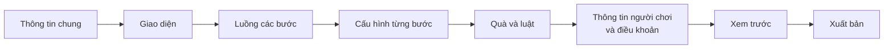
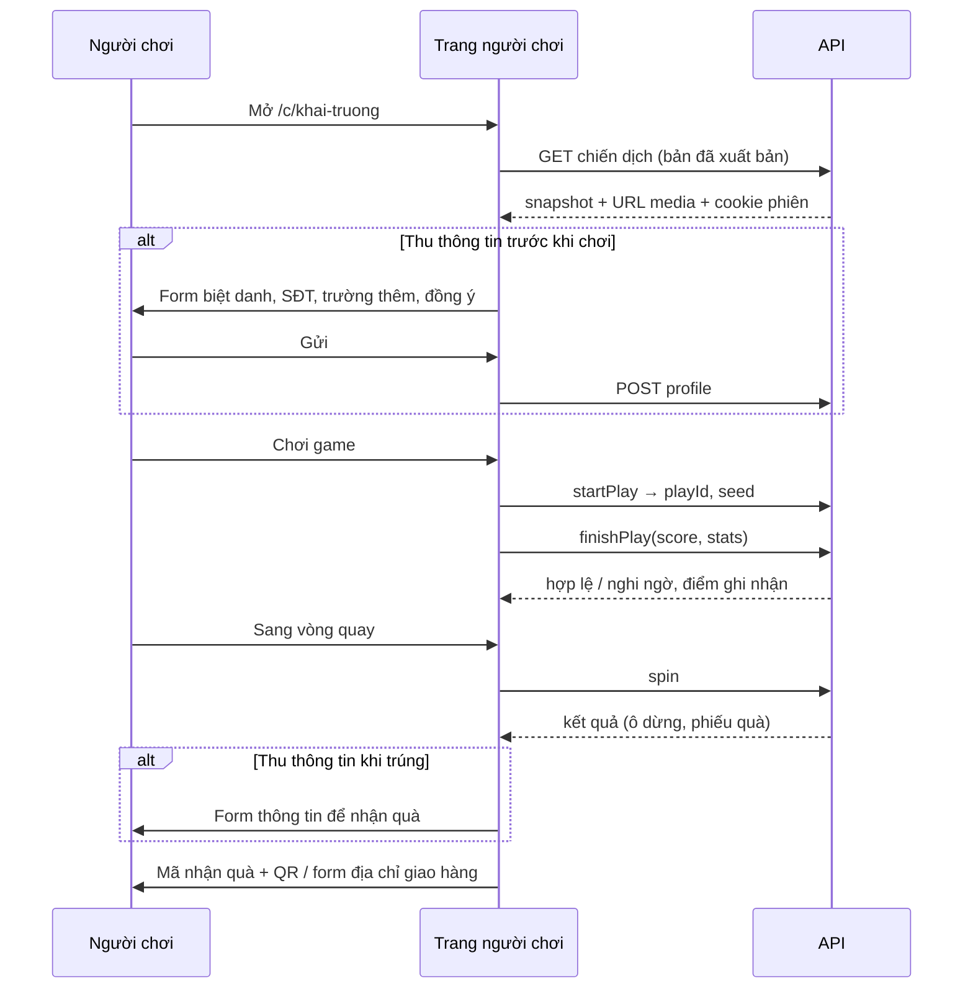

# 04. Nghiệp vụ

## 1. Tạo chiến dịch trong CMS

1. **Thông tin chung**: tên, nhãn hàng, đường dẫn (`slug`, tự gợi ý từ tên), thời gian bắt đầu/kết thúc.
2. **Giao diện**: lấy từ hồ sơ nhãn hàng, cho phép ghi đè riêng cho chiến dịch.
3. **Luồng**: thêm bước từ thư viện template (game, xếp hạng, phần thưởng), kéo thả để sắp xếp. Chọn cách điều hướng: tuần tự (xong bước này sang bước kia) hoặc thanh tab (người chơi tự chuyển, ví dụ giữa "Chơi game" và "Bảng xếp hạng").
4. **Cấu hình từng bước**: form tự sinh từ lược đồ module, xem trước trực tiếp bên cạnh.
5. **Quà và luật**: phân bổ quà từ kho tổng, chọn cách phát quà, đặt luật lượt, giới hạn, kỳ xếp hạng, quà theo hạng.
6. **Thông tin người chơi**: thời điểm thu (trước khi chơi / khi trúng), các trường thêm, nội dung điều khoản và đồng ý xử lý dữ liệu.
7. **Xem trước**: chạy toàn bộ luồng trong khung điện thoại với dữ liệu giả lập; không ghi dữ liệu thật, không trừ quà.
8. **Xuất bản** (mục 3).

Bản nháp tự lưu. Thanh trạng thái luôn cho biết "Bản nháp có thay đổi chưa xuất bản" khi khác bản đang chạy.

## 2. Template và "Đồng bộ từ template"

- Khi thêm một bước từ template, cấu hình được **sao chép** vào chiến dịch kèm `templateId` và `templateRevision`.
- Sửa template sau đó **không** ảnh hưởng chiến dịch.
- Nếu template có bản mới hơn, CMS hiện thông báo "Template đã cập nhật" ở bước đó. Nút **Đồng bộ từ template** hiện danh sách trường thay đổi để chọn áp dụng toàn bộ hoặc từng trường. Đồng bộ chỉ đổi bản nháp; phải xuất bản mới có hiệu lực.

## 3. Xuất bản

Khi bấm Xuất bản, API kiểm tra rồi mới tạo phiên bản mới:

| Kiểm tra | Ví dụ lỗi |
|---|---|
| Cấu hình mọi bước hợp lệ theo lược đồ | "Bước Hứng quà: cần ít nhất 1 vật phẩm cộng điểm" |
| Có thời gian bắt đầu < kết thúc | |
| Mọi ô vòng quay gắn quà đã phân bổ | "Ô 3 gắn quà chưa phân bổ" |
| Bước xếp hạng có bước game làm nguồn | |
| Luật hợp lệ và không mâu thuẫn | |
| `slug` chưa bị chiến dịch khác dùng | |

Sau khi xuất bản:

- Tạo `campaign_versions` mới và trỏ `published_version_id` vào đó.
- Tạo hoặc cập nhật `leaderboard_periods` theo cấu hình kỳ. Kỳ đã chốt không bị đổi.
- Nếu dùng cách phát quà "rải đều", tạo hoặc bổ sung `pacing_slots` cho phần quà mới phân bổ.
- Trạng thái tự đổi theo lịch: `scheduled` trước giờ bắt đầu, `live` trong thời gian chạy, `ended` sau giờ kết thúc. Quản trị viên có thể **Tạm dừng** (`paused`) bất cứ lúc nào.
- Người chơi đang mở trang sẽ nhận bản mới ở lần tải trang kế tiếp. Lượt chơi đang dở vẫn kết thúc theo phiên bản lúc bắt đầu (`plays.version_id`).

Trang người chơi theo trạng thái:

| Trạng thái | Người chơi thấy |
|---|---|
| `scheduled` | Màn "Sắp diễn ra" có đếm ngược, logo nhãn hàng |
| `live` | Chạy luồng chiến dịch |
| `paused` | Màn "Chương trình tạm dừng" |
| `ended` | Màn "Chương trình đã kết thúc", vẫn xem được bảng xếp hạng cuối và "Quà của tôi" |
| không tồn tại / bản nháp | Trang 404 |

## 4. Luồng người chơi

- **Phiên ẩn danh** được tạo ngay khi mở link (cookie đã ký, sống đến hết chiến dịch).
- **Thu thông tin trước khi chơi**: mọi thao tác chơi/quay đều yêu cầu đã có hồ sơ.
- **Thu thông tin khi trúng**: chơi và quay bằng phiên ẩn danh. Trúng quà thì phiếu quà ở trạng thái `pending_profile`, người chơi có **30 phút** (cấu hình được) để nhập thông tin, quá hạn thì quà trả lại phân bổ. Lượt được tính theo phiên + thiết bị cho đến khi có số điện thoại.
- Nếu số điện thoại đã tồn tại trong chiến dịch, phiên hiện tại được gắn vào người chơi cũ (lượt dùng chung).
- Trang **"Quà của tôi"** luôn có ở góc màn hình: danh sách phiếu quà, mã + QR, trạng thái, form địa chỉ cho quà giao tận nơi.

## 5. Khung luật

Mỗi luật là một đối tượng `{ type, ...tham số }` trong `rules` của chiến dịch. API có một **bộ xử lý** cho mỗi loại luật; thêm loại mới là thêm một bộ xử lý và một form cấu hình, không sửa phần khác.

Bộ xử lý luật có thể móc vào các thời điểm:

| Thời điểm | Dùng để |
|---|---|
| `onTurnsQuery` | Cộng lượt theo kỳ (lượt miễn phí theo ngày) |
| `beforePlayStart` | Chặn khi hết lượt chơi game |
| `afterPlayFinish` | (Giai đoạn sau) cộng lượt quay khi đạt điểm |
| `beforeSpin` | Kiểm tra giới hạn quà mỗi người |
| `onPromoCode` | (Giai đoạn sau) nhập mã dự thưởng |

Luật giai đoạn 1:

| Loại | Tham số | Ý nghĩa |
|---|---|---|
| `free_spins` | `amount`, `per`: `campaign` hoặc `day` | Mỗi người được `amount` lượt quay cho cả chiến dịch hoặc mỗi ngày. Cộng vào sổ lượt với `period_key`, nên không cộng trùng. Lượt theo ngày không cộng dồn sang ngày sau. |
| `game_play_limit` | `stepId`, `amount` hoặc không giới hạn, `per`: `campaign` hoặc `day` | Giới hạn số lần bắt đầu chơi game |
| `max_rewards_per_player` | `amount` | Tổng số quà tối đa mỗi người. Giới hạn riêng từng món nằm ở `campaign_prizes.per_player_limit` |

## 6. Phát quà ngẫu nhiên (vòng quay)

Toàn bộ một lượt quay chạy trong **một giao dịch** PostgreSQL:

1. Khóa người chơi/phiên (`SELECT … FOR UPDATE`) để một người không quay song song hai lượt.
2. Kiểm tra chiến dịch đang `live`, người chơi chưa bị chặn, số lượt còn lại > 0, chưa vượt `max_rewards_per_player`.
3. Ghi `−1` vào sổ lượt.
4. Lấy danh sách phần quà **đủ điều kiện**: `issued_qty < allocated_qty`, số đã phát hôm nay < `daily_limit`, người này chưa vượt `per_player_limit` của món đó.
5. Chọn kết quả theo cách phát quà của chiến dịch (bên dưới).
6. Nếu trúng: khóa dòng `campaign_prizes`, tăng `issued_qty`, tạo `rewards` với mã nhận quà.
7. Ghi `spins`. Trả về: ô dừng (theo cấu hình vòng quay), phiếu quà nếu có, số lượt còn lại.

Nếu giao dịch lỗi ở bất kỳ bước nào, mọi thay đổi bị hủy, kể cả lượt bị trừ. Do vậy **không bao giờ phát quá số lượng**, kể cả khi nhiều người quay cùng lúc.

### Cách A: Trọng số + tồn kho

- Mỗi phần quà có `weight`; chiến dịch có thêm `loseWeight` cho kết quả "Chúc may mắn".
- Chọn ngẫu nhiên theo trọng số **chỉ trong các phần quà đủ điều kiện**. Món hết hàng hoặc chạm giới hạn ngày tự bị loại, phần trọng số của nó coi như trượt.
- Ví dụ: Giảm 10% (30), Bình nước (10), Chúc may mắn (60). Khi Bình nước hết, tỉ lệ trúng Giảm 10% vẫn là 30%, trượt thành 70%.
- Ưu điểm: dễ hiểu, dễ đặt. Rủi ro: nếu đặt trọng số cao, quà có thể hết sớm. CMS hiện **ước tính ngày hết quà** dựa trên số lượt quay dự kiến để người vận hành điều chỉnh.

### Cách B: Rải đều theo thời gian

- Khi xuất bản, mỗi suất quà được gán một thời điểm "mở" trải đều trong thời gian chiến dịch, có lệch ngẫu nhiên nhỏ trong khung của nó (bảng `pacing_slots`). Ví dụ 70 bình nước trong 7 ngày → khoảng 10 suất mỗi ngày, mỗi suất mở vào một giờ ngẫu nhiên.
- Khi quay: nếu có suất **đã mở mà chưa ai nhận** (thuộc phần quà đủ điều kiện), người quay trúng suất mở sớm nhất. Không có thì trượt.
- Ưu điểm: quà không bao giờ hết sớm; người chơi ngày cuối có cơ hội như ngày đầu. Đặc điểm cần biết: nếu lâu không có ai quay, các suất đã mở dồn lại và những người quay tiếp theo sẽ trúng liên tiếp.
- Khi phân bổ thêm quà giữa chừng, suất mới được rải trên khoảng thời gian còn lại.

### Ô dừng trên vòng quay

Máy chủ trả về phần quà trúng (hoặc trượt). Trang người chơi chọn một ô gắn với phần quà đó (nếu nhiều ô cùng quà thì chọn ngẫu nhiên một ô; trượt thì chọn một ô "Chúc may mắn") và diễn hoạt cảnh dừng đúng ô.

## 7. Xếp hạng

- **Nguồn điểm**: các lượt chơi `valid` của bước game được chọn, nằm trong khoảng thời gian của kỳ.
- **Cách tính**: `best` (điểm cao nhất một lượt) hoặc `sum` (tổng điểm). Bằng điểm thì ai đạt điểm đó **sớm hơn** xếp trên.
- **Kỳ**: `daily`, `weekly` (thứ Hai đến Chủ nhật), `whole`, hoặc `custom` (danh sách khoảng thời gian tự đặt). Mỗi kỳ có bộ quà theo hạng riêng (lấy từ phân bổ `purpose = leaderboard`).
- **Chốt bảng**: khi kỳ hết hạn, kỳ chuyển `closed` và kết quả được ghi vào `leaderboard_results` với quà đề xuất. Việc chốt chạy khi có lời gọi đầu tiên sau giờ kết thúc, hoặc khi quản trị viên bấm "Chốt ngay"; không phụ thuộc lịch chạy định kỳ của nơi triển khai.
- **Duyệt** (quản trị viên hoặc vận hành): xem danh sách top kèm cảnh báo (nhiều lượt nghi ngờ, nhiều người chung thiết bị). Đánh dấu loại người gian lận; hệ thống **đôn hạng** người phía sau và cập nhật quà đề xuất. Bấm **Duyệt và phát quà** → kỳ chuyển `approved`, tạo phiếu quà cho từng người.
- **Hiển thị cho người chơi**: bục top 3, danh sách, thứ hạng của tôi (kể cả ngoài top), quà theo hạng, đếm ngược kết thúc kỳ. Kỳ đã chốt hiện nhãn "Đang chờ công bố" cho đến khi duyệt.

## 8. Trao quà

### Tại quầy

- **Trang đổi quà** (trong CMS, tối ưu cho điện thoại): nhân viên đổi quà đăng nhập, chọn chiến dịch được giao, **quét QR** bằng camera hoặc **nhập mã** 8 ký tự.
- Màn hình hiện: tên quà, ảnh, biệt danh và SĐT che bớt (người chơi đọc 3 số cuối để đối chiếu), trạng thái. Nút **Xác nhận đã trao**.
- Phiếu đã trao, đã hủy, quá hạn, hoặc thuộc chiến dịch khác đều bị từ chối với thông báo rõ ràng.
- Trong CMS, vận hành viên cũng có thể tìm theo SĐT/mã trong danh sách phiếu quà và bấm "Đã trao".

### Giao tận nơi

- Người chơi điền họ tên, SĐT nhận hàng, tỉnh/thành, địa chỉ trong "Quà của tôi" → `awaiting_shipment`.
- Vận hành viên xem danh sách cần giao, xuất Excel cho đơn vị vận chuyển, cập nhật `shipped` (kèm mã vận đơn) và `delivered`. Nhập hàng loạt trạng thái bằng file Excel ở giai đoạn sau.

## 9. Kho quà

- Nhập món quà mới: tên, ảnh, giá trị, cách nhận, số lượng.
- **Điều chỉnh tồn kho**: tăng/giảm `total_qty` kèm lý do, ghi nhật ký. Không cho giảm dưới tổng đã phân bổ.
- **Phân bổ** cho chiến dịch: chọn món, số lượng, mục đích (vòng quay/xếp hạng), giới hạn ngày, giới hạn mỗi người, trọng số.
- **Trả quà dư** khi chiến dịch kết thúc.
- Màn tổng quan mỗi món: tổng, đã phân bổ (theo chiến dịch), đã phát, đã trao, còn trong kho.

## 10. Báo cáo

Theo từng chiến dịch, lọc theo khoảng ngày:

- **Tổng quan**: lượt mở trang, người chơi mới, lượt chơi game (hợp lệ/nghi ngờ), lượt quay, quà đã phát, tỉ lệ chuyển đổi giữa các bước; biểu đồ theo ngày.
- **Quà**: theo từng món: phân bổ, đã phát, đã trao/đã giao, còn lại, quá hạn/hủy.
- **Người chơi**: tìm theo biệt danh/SĐT, xem lịch sử lượt chơi, lượt quay, phiếu quà; chặn người chơi.
- **Người trúng**: danh sách phiếu quà với trạng thái.
- **Xuất Excel** cho cả ba danh sách. Người xem báo cáo thấy SĐT đã che; quản trị viên và vận hành thấy đầy đủ.
